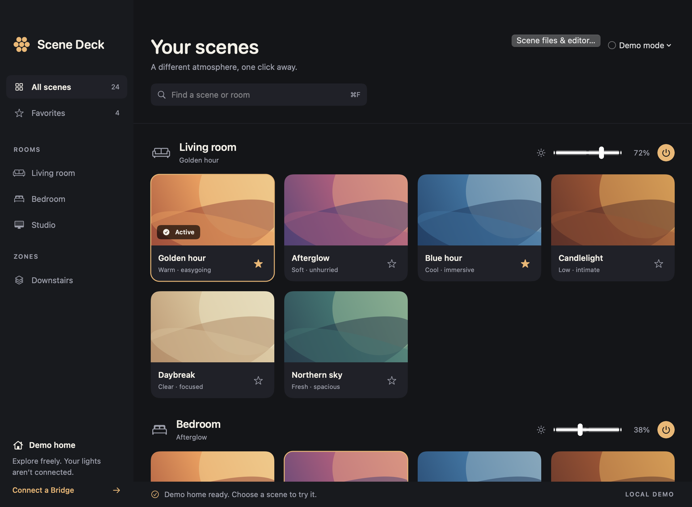

# Scene Deck

**Scene Deck is a native Mac app for Philips Hue.** Control your lights, switch scenes, and organize favorites right from your desktop. A Hue Bridge is required to control real lights.

- **Scene library:** browse by room or zone, search by name, star favorites, and revisit recently played scenes.
- **Quick lighting controls:** activate scenes, adjust room/zone brightness, or turn a group on and off. Use ⌘1–⌘9 for favorites while the app is active.
- **Scene editor:** create, duplicate, and edit supported static scenes with a color picker, brightness, and warmth controls. Import/export local Scene Deck JSON files and review changes before saving to the Bridge.
- **Bridge updates:** the library refreshes when lighting changes. Switch between saved Bridges; after your Mac sleeps, choose Reconnect to resume.
- **Offline demo:** try the interface with sample rooms and scenes before connecting any lights.

For real lights, your Mac must reach your Hue Bridge on the local network. Each Mac pairs with the Bridge’s physical button and keeps its own access key in macOS Keychain. No Apple Home setup is required. Scene Deck is an independent app, unaffiliated with Philips Hue or Signify.



## Download the beta

**[Download Scene Deck 0.4.0 beta 1 for Apple silicon](https://github.com/movieanimals/scene-deck/releases/download/v0.4.0-beta.1/Scene-Deck-macOS-arm64.zip)** · [Release notes and checksums](https://github.com/movieanimals/scene-deck/releases/tag/v0.4.0-beta.1)

Requires **macOS 13 or later**, an **Apple silicon Mac** (M1 or newer), and a **Philips Hue Bridge with API v2** for real lights. Intel Macs and Bluetooth-only bulbs are not supported by this download. The offline demo needs no Bridge.

1. Download **Scene-Deck-macOS-arm64.zip** from the link above or the release’s **Assets** list. The GitHub “Source code” archives are for building, not installing.
2. Double-click the ZIP in Finder. Move **Scene Deck.app** to your Applications folder. Quit an older copy before replacing it; avoid launching a second copy from Downloads.
3. Open **Scene Deck** from Applications. To keep it in the Dock, right-click its Dock icon → **Options → Keep in Dock**.

**Beta signing limitation:** this build is ad-hoc signed, **not Developer ID signed or notarized**. macOS may say Apple cannot verify it is free of malware and block the downloaded copy. A valid local signature does not mean Apple has notarized it. If blocked, leave the warning in place and use the source-build instructions below, or wait for a notarized release. Do not remove quarantine or disable Gatekeeper. [Apple explains these alerts](https://support.apple.com/en-us/102445).

## Connect your lights

1. Choose **Connect a Bridge**, then **Find my Bridge** (or enter its address and ID).
2. Choose **Verify secure connection**. Allow the app’s expected Local Network request if prompted.
3. Press the physical Bridge button, then choose **I pressed the Bridge button — Pair**.
4. Review your loaded scenes, then choose **Finish setup & enable controls**. This enables your own scene clicks and brightness adjustments; completing setup itself changes no lights.

Each Mac pairs separately and stores its own Bridge access key in device-only macOS Keychain. The app package contains no credentials, private Bridge configuration, or scene inventory. A MacBook must pair for itself. Saved connections restore on launch after setup is complete, except when paused after sleep. Sleep closes active sessions and persists a pause across relaunches; wake never reconnects automatically. Choose **Reconnect** when ready. A rebuilt ad-hoc-signed app may require renewed Keychain access.

Use **Disconnect / switch Bridge** in connection setup to select another saved Bridge or pair a new one. Disconnecting retains each Bridge’s key, favorites, and last view, and stays disconnected across relaunch. Selecting a saved Bridge makes no request until you choose **Reconnect**. **Forget this Mac’s saved access** is a separate destructive action.

Demo mode is available before connection; launch with `open "dist/Scene Deck.app" --args --demo` to keep a verification run offline. Favorites are local. Search with **⌘F**, star scenes for the menu bar, click a scene to recall it, and release a brightness slider to commit its room/zone level. Use the power button beside a room or zone to turn that group on or off. Recently played keeps the last 20 confirmed scene recalls per Bridge; failed commands are excluded. **⌘1–⌘9** recall the first nine favorites shown in the Scenes menu while Scene Deck is active. Right-click a scene to edit, export, or duplicate it. The editor’s color picker prepares a static scene locally; saving still requires a preview and confirmation. Screen colors are approximate and depend on bulb gamut.

## Build and test

With Apple Command Line Tools installed:

```sh
git clone https://github.com/movieanimals/scene-deck.git
cd scene-deck
./scripts/build.sh
open "dist/Scene Deck.app" --args --demo
```

Run `./scripts/test.sh` and `./scripts/test-trust.sh` for the synthetic functional and TLS checks.

No downloaded dependencies, developer account, package installation, or Xcode project generation is needed. Build scripts keep caches under `.build/local`. The trust tests use native macOS Security with network certificate fetching disabled and install no roots. Restricted automation sandboxes may need access to the native trust service.

The supplied Swift package also includes XCTest tests for a full Xcode installation. The direct compiler harness is the verified path on a Command-Line-Tools-only machine; `swift test` may fail there because XCTest/PlatformPath is absent.

## Security and current scope

- HTTPS only; redirects refused. App-scoped, pinned OpenHue-published CA roots validate server chain, validity, exact endpoint and Bridge identity. No system roots installed. The legacy CN policy is explicit; see [trust provenance](docs/TRUST-PROVENANCE.md).
- Pairing is one attempt per explicit user action. No key is printed, exported, or included in screenshots. Registration and saved-connection failures fail closed.
- Setup loads resources read-only. Control is enabled by explicit setup completion. Live updates invalidate/refetch authoritative Bridge state; command receipts never invent active scenes.
- Existing scenes are primary. **Scene files & editor** supports local import/export and static scene creation/editing with explicit room/light mapping and a final preview. See [scene files](docs/SCENE-FILES.md). Dynamic playback editing, proprietary gallery assets, and iPhone feature parity are outside this version.
- Real read-only pairing and inventory were verified. Scene, brightness, and power writes were tested using mocks; no physical light changes were made during development verification.

## Distribution

The [release checklist](docs/DISTRIBUTION.md) tracks Developer ID signing, notarization, and clean-Mac validation still needed for a broadly installable release. This public prerelease is intended for technical beta testers. No Apple account changes or notarization submission have been made.

## Homepage handoff

[assets/homepage-handoff.json](assets/homepage-handoff.json) and [assets/scene-deck.png](assets/scene-deck.png) are ready for a separate homepage editor. They describe a downloadable native Mac app, not an embedded web app. No homepage files are changed by this project.
