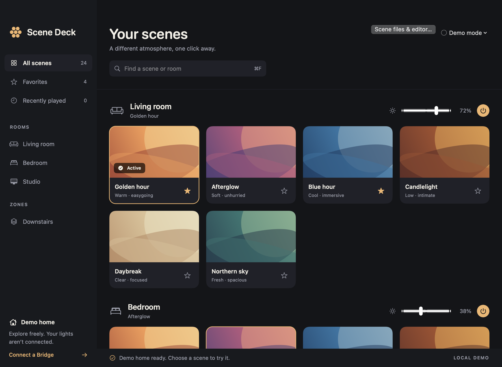
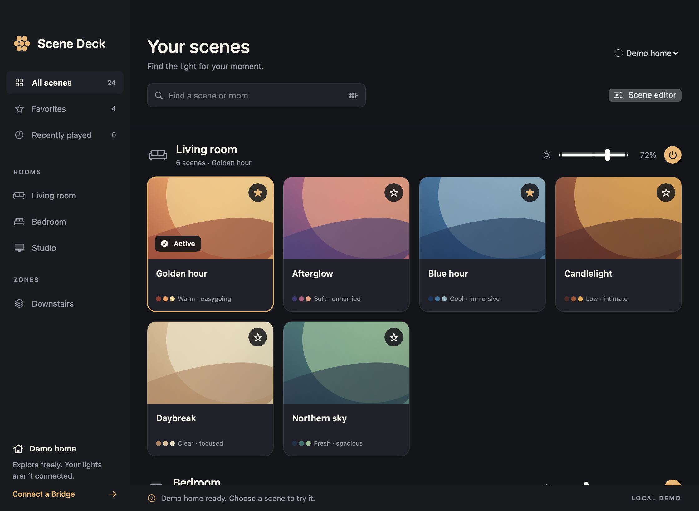

# Scene library refresh and visual checkpoint

Prepared 2026-10-11. **Local, unreleased checkpoint: 0.4.1 build 6.** The installed app and public 0.4.0 beta 1 release remain unchanged. No Bridge scenes, lights, credentials, or security settings were changed during this work.

## Scene updates

Scene Deck lists scenes saved to the Bridge. The existing installed app was inspected read-only and already contained the newly added Halloween scenes. A library filter can hide scenes: choose All scenes or the appropriate room and clear the search. The released beta's connection menu offers Reconnect to reload inventory without a new pairing when saved access remains valid.

This checkpoint adds Refresh scenes in the window and menu bar, plus ⌘R. Initial connection, manual refresh, app foreground, Bridge events, event-stream restoration, and successful lighting commands use one authoritative resource-read queue. Foreground reads skip inventory updated within five seconds. A 60-second fallback checks stale inventory while connected. Event bursts debounce for 250 ms and resource reads start no more often than once per second. Transient read failures retry with bounded exponential backoff, retaining the last inventory and showing an unavailable state. These retries never resend lighting commands.

Successful reads replace the inventory, including additions, renames, and deletions. Deleted room/zone selections return to All scenes. Favorite identities remain stored; deleted scenes stop appearing. Revoked authorization disables ordinary refresh and offers explicit Reconnect. Sleep still closes connections and persists a pause: foreground, polling, and late responses cannot resume it. Reconnect remains an explicit action after sleep.

[Hue's official API v2 overview](https://developers.meethue.com/new-hue-api/) documents local proactive change events. Its detailed reference required login/returned HTTP 403 during this work. The implementation retains the existing generic event-invalidation approach and reconciles full inventory rather than relying on undocumented event guarantees. This is not a proprietary scene-gallery browser or a promise of iPhone feature parity.

## Visual changes

Larger scene artwork, two-line names, independent favorite buttons, room counts, clearer search/actions, restrained hover/active highlights, and visible refresh status. Bridge artwork uses supported saved light colors, approximate warmth swatches, or a neutral unavailable preview. No external scene imagery or decorative animation was added.

Offline native captures were inspected at 1120×820 and the 900×640 minimum. The demo does not show live-only refresh controls; their state transitions are covered by synthetic tests. A connected-device visual acceptance pass remains for a later authorized installation.

| Before | After |
| --- | --- |
|  |  |

[Minimum-size capture](compact.png)

## Verification and launch

- Build succeeded using existing Swift 5.8.1 Command Line Tools on Apple silicon; no new tooling or accounts.
- 186 synthetic functional checks passed, including 16 refresh checks covering additions, renames, deletions, burst coalescing, retry recovery, foreground, fallback polling, stream restoration, throttling, sleep cancellation, favorites, and revoked access.
- 16 offline TLS checks passed; no roots installed and no Bridge requests.
- Fresh targeted review found no remaining material issue after fixing revoked-access recovery.
- Design detector reported no findings. Native offline screenshots were inspected at both window sizes.
- ZIP freshly extracted under `/tmp` passed strict deep signature verification. Documents-folder copies acquired Finder metadata after build; verification of those copies reported FinderInfo, while the fresh ZIP extraction passed. No quarantine or security setting was changed.
- Installed app remains version 0.4.0. No push, tag, publication, or installation performed.

Local artifact: `local/Scene-Deck-0.4.1-refresh-checkpoint.zip` (ignored by Git).

SHA-256: `0f94280d2b889652885a3a524e175314a882abb036b972154022ae96938507bf`

To reproduce and launch offline from the repository:

```sh
./scripts/test.sh
./scripts/test-trust.sh
./scripts/build.sh
open "dist/Scene Deck.app" --args --demo
```

The checkpoint is ad-hoc signed, not Developer ID signed or notarized. It does not resolve the public beta's Apple verification warning. The existing README includes Apple's per-app Open Anyway instructions for trusted downloads; Developer ID signing/notarization remains a separate distribution step.
